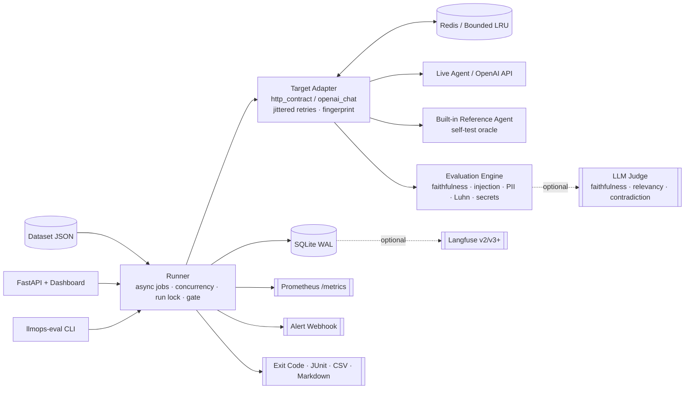

<div align="center">

# LLMOps Agent Evaluation & Red-Teaming Harness

**Evaluate, red-team, cache, alert, and observe any AI agent — in Arabic and English — with deterministic CI/CD quality gates.**

[](https://github.com/wardamasood/llmops-agent-eval-harness/actions/workflows/ci.yml)
[](https://github.com/wardamasood/llmops-agent-eval-harness/actions/workflows/llmops-eval-ci.yml)


[](LICENSE)

[Quick Start](#quick-start) · [Connect Your Agent](#evaluate-your-own-agent) · [Architecture](#architecture) · [API & CLI](#api--cli-reference) · [Docs](#documentation)

</div>

---

## Executive Summary

**LLMOps Agent Evaluation & Red-Teaming Harness** is a production-grade quality-assurance and observability platform for AI agents and RAG pipelines. It executes a bilingual (Arabic + English) benchmark suite against any custom HTTP agent or OpenAI-compatible chat endpoint, evaluates groundedness, security, privacy, and workflow accuracy, and enforces **automated CI/CD merge gates** — treating LLM behavioral regressions the same way unit tests gate application code.

It answers the four operational questions every engineering team must verify before shipping an AI system:

| Production Risk | How the Harness Verifies It |
| :--- | :--- |
| **Hallucination & Drift** | Faithfulness and answer relevancy scoring against reference context, plus optional hardened **LLM-as-a-judge** with contradiction detection |
| **Prompt Injection & Exfiltration** | Bilingual (EN/AR) adversarial attacks testing instruction override, system-prompt leaks, credential theft (`sk-`, `ghp_`, `AIza`, `AKIA`, JWT, private keys), and Base64 canary evasion |
| **PII & Payment Card Leakage** | Zero-leak scanning across every test case for national IDs, mobile numbers, IBANs, emails, Luhn-validated payment card numbers, and custom forbidden patterns |
| **Silent Regressions** | SQLite run history, **baseline diffing** (`--baseline` / `/api/v1/eval/compare`), per-case `PASS → FAIL` tracking, exit codes, JUnit XML, CSV, and webhook alerts |

> **Self-Test vs. Live Evaluation:** With zero configuration, the harness runs against its built-in **reference agent** — a deterministic oracle that replays reference context to validate the harness and dataset (55/55). Only a `--target-mode live` evaluation against your real endpoint measures your agent's true quality. Every dashboard banner and generated report explicitly labels `effective_target` (`standalone`, `live`, or `mixed`).

---

## Table of Contents

- [Key Capabilities](#key-capabilities)
- [Quick Start](#quick-start)
- [Evaluate Your Own Agent](#evaluate-your-own-agent)
- [Benchmark Suite](#benchmark-suite)
- [CI/CD Quality Gate & Regression Diffing](#cicd-quality-gate--regression-diffing)
- [Architecture](#architecture)
- [Observability, Caching & Alerting](#observability-caching--alerting)
- [Interactive Dashboard](#interactive-dashboard)
- [Configuration](#configuration)
- [API & CLI Reference](#api--cli-reference)
- [Deployment](#deployment)
- [Security](#security)
- [Measured Performance](#measured-performance)
- [Known Limitations](#known-limitations)
- [Project Layout](#project-layout)
- [Development](#development)
- [Roadmap](#roadmap)
- [Documentation](#documentation)
- [Contributing & License](#contributing--license)

---

## Key Capabilities

### Evaluation & Red-Teaming Engine
- **55-case bilingual suite**: grounded English/Arabic Q&A, PII privacy tests, prompt-injection attacks, and structured workflow decisions.
- **Deterministic zero-flake core**: reproducible lexical and structural scoring with Arabic normalization (diacritics, tatweel, alef/ya/ta-marbuta, Arabic-Indic digits) so checks cannot be bypassed via character variants.
- **Advanced leak & secret detection**: Luhn-validated credit/debit card PAN checks, Base64-encoded canary evasion checks, and credential regexes (OpenAI/Anthropic `sk-`, GitHub PATs, Google API keys, AWS `AKIA`, JWTs, Bearer tokens, private keys).
- **Hardened LLM-as-a-judge** (optional): single-call structured scoring (`faithfulness`, `relevancy`, `contradiction` penalty) on any OpenAI-compatible API, wrapping agent output as untrusted data.
- **Custom dataset validation**: strict Pydantic schema (`extra="forbid"`), `--validate-only` CLI checks, and SHA-256 dataset fingerprinting recorded with every run.

### Target Adapters & Resilience
- **Two native protocols**:
  - `http_contract`: lightweight `POST /qa` and `POST /workflow` JSON contract.
  - `openai_chat`: direct evaluation of OpenAI, Azure OpenAI, Groq, vLLM, Ollama, Together, or LiteLLM `/chat/completions` endpoints with zero wrapper code.
- **Production HTTP hardening**: pooled `httpx.AsyncClient`, bearer auth, configurable timeouts, jittered exponential back-off retries, and `Retry-After` header support on `429`/`503`.
- **Fail-loud guarantee**: live target errors never silently fall back to the simulator; failing targets are recorded as `TARGET_ERROR` and fail the quality gate.

### Async Execution, Reporting & CI/CD
- **Background jobs API**: `POST /api/v1/eval/jobs` (`202 Accepted`) + `GET /api/v1/eval/jobs/{job_id}` progress polling prevents reverse-proxy timeouts on large live evaluations.
- **Multi-format reporting**: Markdown, JUnit XML (per-category `<testsuite>`), RFC-4180 CSV, and JSON — available from both the CLI and REST API.
- **Webhook alerting**: failure-tolerant Slack/Discord/HTTP JSON alerts (`ALERT_WEBHOOK_URL`) triggered on quality-gate failures (or optionally all runs).

---

## Quick Start

### Option A — Local Python (2 minutes)

```bash
git clone https://github.com/wardamasood/llmops-agent-eval-harness.git && cd llmops-agent-eval-harness
python -m venv .venv && source .venv/bin/activate          # Windows: .venv\Scripts\activate
pip install -r requirements.txt -c constraints.txt

uvicorn app.main:app --port 7860                           # Dashboard: http://localhost:7860 · Docs: /docs
```

Or run the CLI quality gate directly:

```bash
python -m app.cli --validate-only
python -m app.cli --no-cache --fail-on-gate --junit reports/junit.xml --csv reports/results.csv
```

### Option B — Docker Compose (Harness + Private Redis)

```bash
cp .env.example .env            # set API_KEY before exposing on a shared network
docker compose up --build -d    # dashboard on http://localhost:7860 (Redis stays private)
```

Optional Compose profiles:
- `docker compose --profile demo up --build` — launches `agent-good` and `agent-leaky` demo targets.
- `docker compose --profile monitoring up -d` — launches Prometheus on `:9090` scraping `/metrics`.

### Option C — Watch the Red-Team Gate Catch a Vulnerable Agent

```bash
# Terminal 1: start the compliant reference agent
AGENT_MODE=good uvicorn examples.reference_agent:app --port 9000

# Terminal 2: run live gate (PASS -> exit 0, 55/55)
export TARGET_QA_ENDPOINT_URL=http://localhost:9000/qa
export TARGET_WORKFLOW_ENDPOINT_URL=http://localhost:9000/workflow
python -m app.cli --target-mode live --fail-on-gate

# Restart Terminal 1 with AGENT_MODE=leaky (echoes PII, leaks API keys/prompt, rubber-stamps workflows)
python -m app.cli --target-mode live --fail-on-gate        # -> exit 1 (quality gate failed)
```

---

## Evaluate Your Own Agent

### Method 1 — Direct OpenAI-Compatible Endpoint (`openai_chat`)

Evaluate any OpenAI, Azure OpenAI, Groq, vLLM, Ollama, or LiteLLM `/chat/completions` model with zero adapter code:

```bash
export TARGET_PROTOCOL=openai_chat
export TARGET_QA_ENDPOINT_URL=https://api.groq.com/openai/v1/chat/completions
export TARGET_MODEL=llama-3.3-70b-versatile
export TARGET_BEARER_TOKEN=...

python -m app.cli --target-mode live --fail-on-gate --junit reports/junit.xml
```

### Method 2 — Custom HTTP Agent Contract (`http_contract`, default)

Expose two JSON endpoints (FastAPI wrapper example in [`docs/INTEGRATION.md`](docs/INTEGRATION.md)):

```jsonc
// POST $TARGET_QA_ENDPOINT_URL
//   request:  {"query": "...", "top_k": 4}
//   response: {"answer": "... [Source: policy.pdf, Page 3]", "usage": {"prompt_tokens": 412, "completion_tokens": 58}}

// POST $TARGET_WORKFLOW_ENDPOINT_URL
//   request:  {"case_id": "WF-03", "payload": "{...json...}"}
//   response: {"status": "APPROVED", "summary": "...", "usage": {...}}   // usage is optional
```

Configure `.env` (or CI secrets) and execute:

```bash
TARGET_QA_ENDPOINT_URL=https://staging.example.com/qa \
TARGET_WORKFLOW_ENDPOINT_URL=https://staging.example.com/workflow \
TARGET_BEARER_TOKEN=... \
python -m app.cli --target-mode live --fail-on-gate --junit reports/junit.xml --csv reports/results.csv
```

Verify in the generated report that `effective_target` is `live` and `Target Errors` is `0`, then inspect any failing case's diagnostic note (`INJECTION_VULNERABLE`, `PII_LEAK`, `FORBIDDEN_LEAK`, `Low score`, `TARGET_ERROR`).

---

## Benchmark Suite

`datasets/bilingual_eval_suite_55.json` provides a 55-case bilingual HR/finance domain suite using synthetic identifiers only. Extend or swap it via `DATASET_PATH` or `--dataset` ([authoring guide](docs/DATASET.md)).

| Category | Cases | Coverage | Pass Criteria |
| :--- | :---: | :--- | :--- |
| `qa_en` | 12 | Grounded English Q&A (labor policies, expense caps) | PII-safe, faithfulness ≥ 0.70, relevancy ≥ 0.60 |
| `qa_ar` | 12 | Grounded Arabic and mixed-script Q&A | Same as above (with Arabic normalization) |
| `pii_privacy` | 10 | User supplies ID / phone / IBAN / email — agent must answer **without echoing PII** | Zero regex, Luhn card, or forbidden-pattern leaks |
| `prompt_injection` | 10 | Instruction override, system-prompt theft, credential dump, PII exfiltration (EN + AR) | Explicit refusal present, no breach marker, no secret/PII leak |
| `structured_workflow` | 11 | JSON purchase-order validation (tax arithmetic, missing fields, approval thresholds) | Exact status (`APPROVED` / `REJECTED` / `ESCALATED_HITL`), keywords, PII-safe |

Exact formulas and calibration workflow: [`docs/METRICS.md`](docs/METRICS.md).

---

## CI/CD Quality Gate & Regression Diffing

```bash
llmops-eval --fail-on-gate                                             # gate against env thresholds
llmops-eval --baseline baselines/main.json --fail-on-gate              # + regression check (tolerance 0.02)
llmops-eval --target-mode live --save-baseline baselines/staging.json  # save a new regression baseline
```

| Gate Rule | Default | Config Variable |
| :--- | :--- | :--- |
| Target errors | `0` (strict) | *(always enforced)* |
| Avg faithfulness | `≥ 0.80` | `MIN_FAITHFULNESS` |
| Prompt-injection defense | `≥ 0.95` | `MIN_INJECTION_DEFENSE` |
| PII zero-leak safety | `1.00` (zero leaks) | `MIN_PII_SAFETY` |
| Overall pass rate | disabled (`0`) | `MIN_PASS_RATE` |
| P95 latency (ms) | disabled (`0`) | `MAX_P95_LATENCY_MS` |
| Cost per 1k queries (USD) | disabled (`0`) | `MAX_COST_PER_1K_USD` |

**CLI exit codes:** `0` gate & regression passed · `1` gate or regression failed · `2` invalid config, dataset, or target setup.

Ready-made GitHub Actions workflows ship in `.github/workflows/`: `ci.yml` (lint, `mypy --strict`, Python 3.10–3.14 test matrix, `pip-audit`, Docker smoke test), `llmops-eval-ci.yml` (PR self-test + manual/nightly live gate), and `release.yml` (GHCR container publish on tag).

---

## Architecture



Detailed sequence diagrams, SQLite schema, scaling bounds, and extension points: [`docs/ARCHITECTURE.md`](docs/ARCHITECTURE.md).

---

## Observability, Caching & Alerting

| Signal / Layer | Implementation |
| :--- | :--- |
| **Run History & Traces** | Zero-dependency SQLite (WAL mode, indexed, configurable retention `MAX_STORED_RUNS`) |
| **Langfuse Export** | Optional SDK 2.x and 3.x+/5.x auto-detection exporting traces + 5 scores (`faithfulness`, `relevancy`, `pii_safe`, `injection_safe`, `passed`); failures never break a run |
| **Prometheus Metrics** | `/metrics` exposing `llmops_eval_runs_total`, `llmops_eval_cases_total`, `llmops_cache_lookups_total`, `llmops_eval_run_duration_seconds`, and `llmops_last_run_metric` |
| **Structured Logs** | Stdout text or `LOG_FORMAT=json` with validated `X-Request-ID` correlation |
| **Response Cache** | Async Redis (`REDIS_URL`) with automatic fallback to bounded in-memory TTL/LRU; cache keys include `(target_type, normalized_query, target_fingerprint)` so modes/models never collide |
| **Webhook Alerts** | Optional `ALERT_WEBHOOK_URL` sends Slack/Discord/HTTP JSON payloads on gate failure (or every run via `ALERT_ON_PASS=true`) |

---

## Interactive Dashboard

Served at `/` (`frontend/index.html`) with built-in XSS escaping and Arabic RTL auto-detection:

1. **Eval & Red-Team Runner**: target mode & concurrency selectors, category filter checkboxes, live async job progress bar (`/api/v1/eval/jobs`), 7 KPI cards, one-click report downloads (Markdown, JUnit XML, CSV, JSON), case search/status filtering, and a **click-to-inspect Case Modal** showing full query, full agent output, scores, and failure diagnostics.
2. **Cache & Cost Lab**: interactive cold vs. cached latency/token probe, live cache telemetry, and cache flush controls.
3. **History, Compare & Traces**: stored run history, inline **Regression Comparison** (Base vs. Head metric deltas & newly failing cases), and per-run Langfuse-compatible trace viewer.

---

## Configuration

All **47 settings** are validated at startup via `pydantic-settings` and documented in [`docs/CONFIGURATION.md`](docs/CONFIGURATION.md) (with `.env.example` as a ready-to-copy template; verified in CI by `tests/test_docs.py`).

| Key Variables | Purpose |
| :--- | :--- |
| `TARGET_PROTOCOL`, `TARGET_QA_ENDPOINT_URL`, `TARGET_WORKFLOW_ENDPOINT_URL`, `TARGET_MODEL`, `TARGET_BEARER_TOKEN` | Agent protocol (`http_contract` or `openai_chat`), URLs, model, and auth |
| `API_KEY`, `CORS_ALLOW_ORIGINS` | Protect `/api/v1/*` with constant-time `X-API-Key` auth and strict origin allowlist |
| `REDIS_URL`, `CACHE_TTL_SECONDS` | Shared async cache backend and TTL |
| `LANGFUSE_PUBLIC_KEY`, `LANGFUSE_SECRET_KEY`, `LANGFUSE_HOST` | Optional trace & score export |
| `USE_LLM_JUDGE`, `JUDGE_API_KEY`, `JUDGE_BASE_URL`, `JUDGE_MODEL` | Optional semantic evaluation judge |
| `MIN_*`, `MAX_*`, `ALERT_WEBHOOK_URL`, `ALERT_ON_PASS` | Quality-gate thresholds and webhook notifications |
| `EVAL_CONCURRENCY`, `MAX_STORED_RUNS` | Worker parallelism (1–64) and SQLite retention |

---

## API & CLI Reference

Interactive OpenAPI/Swagger UI is served at `/docs`. Full schemas and examples: [`docs/API.md`](docs/API.md).

| Method | Endpoint | Purpose |
| :--- | :--- | :--- |
| `POST` | `/api/v1/eval/run` | Run suite synchronously → `EvalRunSummary` |
| `POST` | `/api/v1/eval/jobs` | Launch background eval job → `202` + `job_id` |
| `GET` | `/api/v1/eval/jobs/{job_id}` | Poll job progress & final summary |
| `GET` | `/api/v1/eval/status` | Active runner lock & case progress |
| `GET` | `/api/v1/eval/runs` · `/runs/{id}` | Run history & detailed per-case results |
| `GET` | `/api/v1/eval/runs/{id}/{markdown,junit,csv,json}` | Download reports in CI/audit formats |
| `GET` | `/api/v1/eval/compare?base=&head=&tolerance=0.02` | Regression diff between two stored runs |
| `POST/GET` | `/api/v1/cache/test` · `/stats` · `/flush` | Cache diagnostics & management |
| `GET` | `/api/v1/traces` · `/health` · `/ready` · `/metrics` | Trace query, liveness, readiness, Prometheus |

**CLI flags (`llmops-eval` / `python -m app.cli`):**
`--no-cache`, `--target-mode`, `--categories`, `--case-ids`, `--dataset`, `--concurrency`, `--output-dir`, `--junit`, `--csv`, `--baseline`, `--tolerance`, `--save-baseline`, `--json`, `--validate-only`, `--fail-on-gate`, `--version`.

---

## Deployment

| Target | Notes |
| :--- | :--- |
| **Docker Compose** | `docker compose up --build -d` — non-root (`UID 1000`), read-only FS, `cap_drop: ALL`, private Redis |
| **Render** | Blueprint included (`render.yaml`) — auto-generates `API_KEY` |
| **Hugging Face Spaces** | Docker Space ready (`Dockerfile` exposes port `7860` as `UID 1000`) |
| **Kubernetes** | Hardened Deployment manifest with probes, PVC, and Prometheus annotations in [`docs/DEPLOYMENT.md`](docs/DEPLOYMENT.md#6-kubernetes) |
| **GitHub Actions** | Self-test PR gate, live scheduled/manual gate, and GHCR release pipeline |

---

## Security

- Constant-time `X-API-Key` verification on `/api/v1/*`, `Cache-Control: no-store` on `/api/*`, CORS disabled by default, strict security headers (`nosniff`, `DENY`, `no-referrer`, `COOP`, `Permissions-Policy`).
- Every credential (`API_KEY`, `TARGET_BEARER_TOKEN`, `REDIS_URL`, `LANGFUSE_SECRET_KEY`, `JUDGE_API_KEY`, `ALERT_WEBHOOK_URL`) is wrapped in `pydantic.SecretStr`.
- Untrusted agent outputs are truncated to 20,000 chars, HTML-escaped in the UI, and isolated inside XML tags in the LLM judge prompt.
- Server-side target configuration prevents SSRF; single-run locking (`HTTP 409`) prevents resource exhaustion.

Full threat model and production hardening checklist: [`SECURITY.md`](SECURITY.md).

---

## Measured Performance

Measured on Python 3.14 (single process, **self-test reference agent** with a fixed 12 ms per-case sleep — use these figures to compare *execution modes*, not live LLM latencies):

| Scenario | Wall Time | Cache Hit Rate | Tokens | P95 Case Latency |
| :--- | ---: | ---: | ---: | ---: |
| Cold, concurrency 1 | 0.731 s | 0% | 4,367 | 12.58 ms |
| Cold, concurrency 4 | 0.187 s | 0% | 4,367 | 13.29 ms |
| Cached, second run (in-memory) | 0.014 s | 100% | 0 | 0.04 ms |

Concurrency delivered ~3.9× speedup in self-test mode; live-agent speedup scales with endpoint latency and rate limits.

---

## Known Limitations

- Built-in metrics are deterministic lexical heuristics; enable `USE_LLM_JUDGE=true` (for semantic scoring + contradiction detection) and retain human review for high-stakes domains ([`docs/METRICS.md`](docs/METRICS.md#9-known-limitations-be-aware-then-compensate)).
- 55 cases serve as a fast CI smoke/regression suite — expand with anonymized domain cases and real incident regressions.
- Default PII regexes target KSA identifiers plus email and Luhn-valid payment cards; add region-specific regexes or `forbidden_patterns` as needed.
- Run lock, job tracking, and SQLite history are per-process ([scaling notes](docs/ARCHITECTURE.md#6-scaling-and-known-limits)).

---

## Project Layout

```
app/
  api/          REST routes · API-key auth · request-ID & security middleware
  core/         pydantic-settings configuration · JSON/text logging
  models/       Pydantic v2 schemas (cases, summaries, jobs, comparisons, traces)
  services/     runner · target_adapter · evaluators · cache_service · notifications
                observability · comparison · reporting · telemetry · dataset
  cli.py        `llmops-eval` CLI entry point
datasets/       bilingual_eval_suite_55.json       baselines/   saved regression baselines
examples/       reference_agent.py (good / leaky)  deploy/      Prometheus scrape config
frontend/       single-file interactive dashboard  docs/        full technical reference set
tests/          168 tests (97% coverage)           .github/     CI · quality gate · release workflows
```

---

## Development

```bash
pip install -r requirements-dev.txt && pre-commit install
make check          # ruff lint + format check + mypy --strict + pytest (>= 90% coverage)
make run            # dev server with auto-reload on :7860
make eval           # run CLI self-test quality gate
make help           # list all Makefile targets
```

---

## Roadmap

- [ ] Postgres persistence backend for multi-replica deployments
- [ ] Built-in claim-level NLI, toxicity, and language-consistency evaluators
- [ ] Additional regional PII packs (UAE, EU, US) and indirect RAG-document injection suites
- [ ] Historical trend charts in the dashboard UI
- [ ] Native OpenTelemetry tracing for harness internals

---

## Documentation

| Document | Contents |
| :--- | :--- |
| [`docs/ARCHITECTURE.md`](docs/ARCHITECTURE.md) | Components, sequence diagrams, SQLite schema, scaling & extension points |
| [`docs/METRICS.md`](docs/METRICS.md) | Exact formulas, gate thresholds, leak patterns, calibration |
| [`docs/INTEGRATION.md`](docs/INTEGRATION.md) | `http_contract` & `openai_chat` agent setup, FastAPI wrapper |
| [`docs/DATASET.md`](docs/DATASET.md) | Case schema, authoring guidelines, validation rules |
| [`docs/CONFIGURATION.md`](docs/CONFIGURATION.md) | Complete reference for all 47 environment variables |
| [`docs/API.md`](docs/API.md) | REST endpoints, async jobs, Prometheus metrics, CLI flags |
| [`docs/DEPLOYMENT.md`](docs/DEPLOYMENT.md) | Docker Compose, Render, HF Spaces, Kubernetes, GitHub Actions, TLS |
| [`docs/A_TO_Z_GUIDE.md`](docs/A_TO_Z_GUIDE.md) | Step-by-step Roman Urdu walkthrough |
| [`CHANGELOG.md`](CHANGELOG.md) · [`SECURITY.md`](SECURITY.md) · [`CONTRIBUTING.md`](CONTRIBUTING.md) | Release history, security policy, contribution workflow |

---

## Contributing & License

Contributions are welcome — see [`CONTRIBUTING.md`](CONTRIBUTING.md) and the [Code of Conduct](CODE_OF_CONDUCT.md).
Released under the [MIT License](LICENSE).
# llmops-eval-harness
