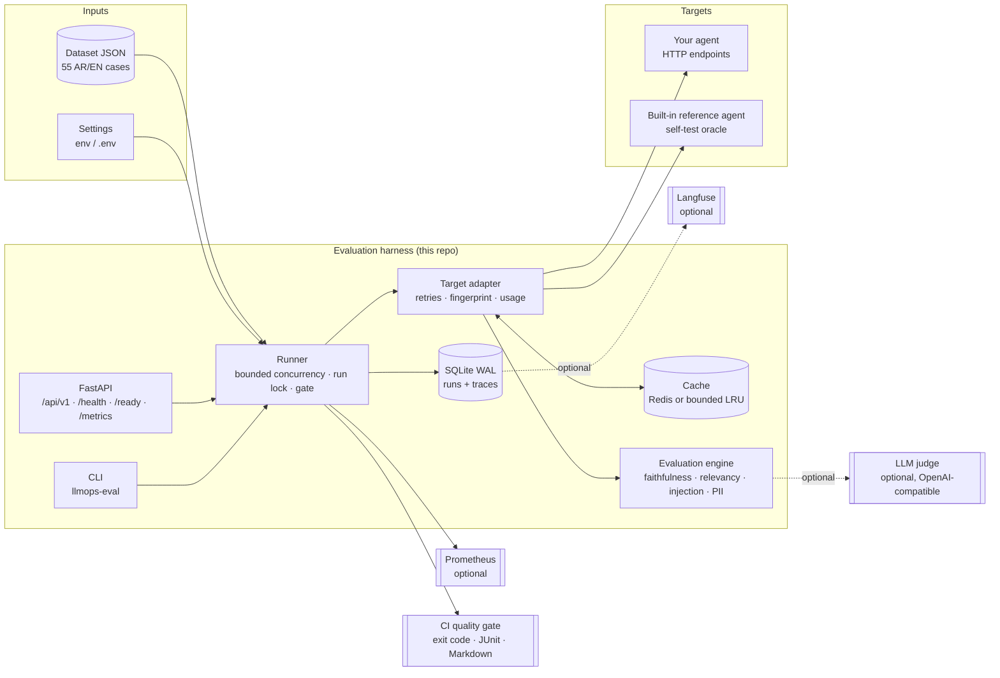
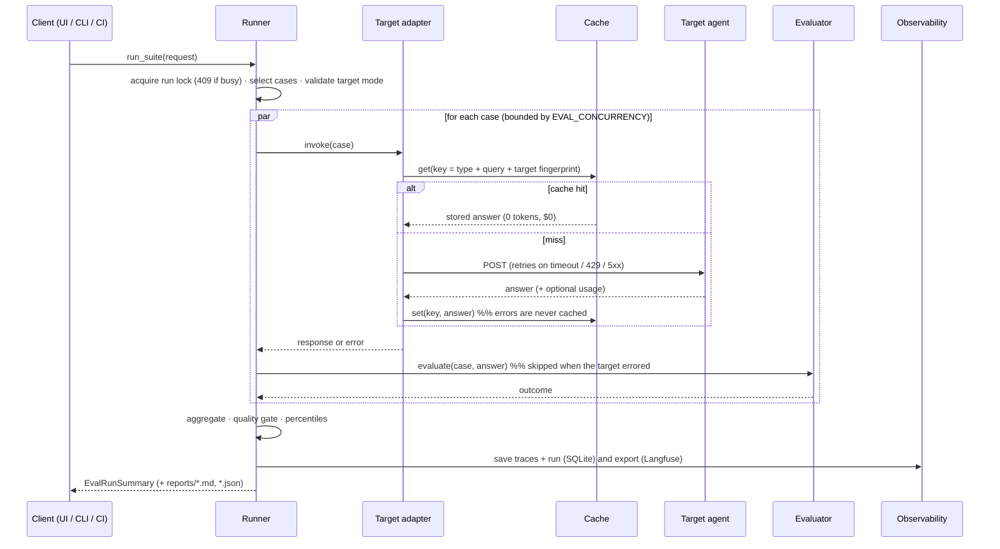

# Architecture

## 1. The big picture



## 2. Life of one evaluation run



## 3. Components

| Module | Responsibility | Notes |
| :--- | :--- | :--- |
| `app/main.py` | Application factory, lifecycle, error mapping | Creates the runner in the lifespan hook; closes pools on shutdown. |
| `app/api/routes.py` | REST endpoints | `system` router is open (probes); `/api/v1/*` requires the API key when configured; includes async jobs & CSV/JUnit/JSON exports. |
| `app/api/middleware.py` | Request ID, access log, security headers | Incoming `X-Request-ID` is accepted only if it matches `[A-Za-z0-9._-]{1,64}`; `/api/*` responses set `Cache-Control: no-store`. |
| `app/core/config.py` | Validated settings | `pydantic-settings`; secrets are `SecretStr`; invalid values fail fast. |
| `app/services/runner.py` | Orchestration, async jobs, gate | One run at a time per process; live progress tracking; results keep dataset order. |
| `app/services/target_adapter.py` | Talk to the agent under test | Supports `http_contract` and `openai_chat` protocols, jittered retries + `Retry-After`; **no silent fallback**. |
| `app/services/notifications.py` | Webhook alerting | Failure-tolerant Slack/Discord/HTTP webhook alerts on quality-gate outcomes. |
| `app/services/cache_service.py` | Response cache | `redis.asyncio` or bounded LRU; Redis faults degrade to memory and are counted. |
| `app/services/evaluators.py` | Metrics | Deterministic heuristics + secret/Luhn/Base64 checks + multi-metric LLM judge. See `METRICS.md`. |
| `app/services/observability.py` | History + tracing | SQLite (WAL, indexed, retention) + Langfuse exporter (SDK 2.x and 3.x+). |
| `app/services/comparison.py` | Regression diff | Quality metrics + per-case pass->fail flips. |
| `app/services/reporting.py` | Markdown / JUnit / CSV | Report states clearly when results came from the self-test agent. |
| `app/services/telemetry.py` | Prometheus metrics | Private registry per app instance. |
| `app/services/dataset.py` | Load / validate / fingerprint | Unknown keys and inconsistent cases are rejected. |
| `app/cli.py` | CI entry point | Exit codes: 0 ok, 1 gate/regression failed, 2 configuration error. |

## 4. Key design decisions

1. **Failures must be loud.** An evaluation harness that quietly substitutes fake answers when the real agent is
   down defeats its own purpose. Live errors count as failed cases, and the gate fails (`Target errors: n/55`).
2. **Self-test vs. real evaluation are different things.** The built-in reference agent is an *oracle* (it replays each
   case's reference context), so it scores ~100% by construction. It proves the harness works. Reports and the
   dashboard label it ("self-test") and every run records `effective_target`.
3. **Cache keys carry a target fingerprint** (`live|<endpoint>` or `standalone|<case_id>`) so answers from different
   targets can never be mixed, and changing the endpoint naturally invalidates entries.
4. **Optional integrations never break a run.** Redis, Langfuse and the LLM judge are wrapped so that failure is
   logged/counted and the run continues (cache -> memory, judge -> heuristic score, Langfuse -> SQLite only).
5. **Async all the way, blocking work off the loop.** HTTP and Redis are async; SQLite and report writing run via
   `asyncio.to_thread`.
6. **Reproducibility.** Every run stores the app version, git SHA, dataset SHA-256, concurrency and target mode.

## 5. Data model (SQLite)

```
eval_runs(run_id PK, timestamp, overall_pass_rate, avg_faithfulness, injection_defense_rate,
          cache_hit_rate, p95_latency_ms, quality_gate_passed, summary_json)   -- full EvalRunSummary as JSON
traces(trace_id PK, run_id, case_id, category, cache_hit, latency_ms, faithfulness, pii_safe,
       injection_safe, tokens, cost_usd, langfuse_exported, created_at)
indexes: eval_runs(timestamp DESC), traces(run_id), traces(created_at DESC)      PRAGMA user_version = 2
```

Retention: after each run, only the newest `MAX_STORED_RUNS` runs (and their traces) are kept.

## 6. Scaling and known limits

- **Single process, single node by design.** The run lock and SQLite file are per process. Running several replicas
  works for the *API* but each replica keeps its own history and may run concurrently. For team-wide history use one
  replica, mount a persistent volume for `data_store/`, or run evaluations from CI and archive `reports/*.json`.
- Throughput is bounded by `EVAL_CONCURRENCY` and your agent's rate limits - raise it gradually.
- SQLite (WAL) comfortably handles the intended write volume (hundreds of rows per run).
- Roadmap items (Postgres backend, async job queue with polling, more metrics) are listed in the README.

## 7. Extension points

| You want to... | Touch |
| :--- | :--- |
| Evaluate a new kind of agent | New `target_type` in `schemas.py` + a branch in `target_adapter._call_live` / `evaluators.evaluate_case` |
| Add a metric | `EvaluationOutcome` + `evaluators.py` + a gate threshold in `Settings` (see CONTRIBUTING) |
| Use another cache | Implement `get/set/flush/stats/ping/connect/aclose` like `LLMCacheService` |
| Export traces elsewhere | Add an exporter next to `LangfuseExporter` and call it from `ObservabilityService.record_traces` |
